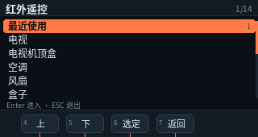
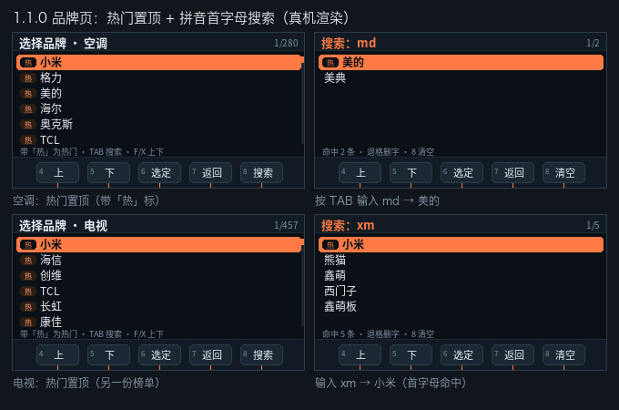
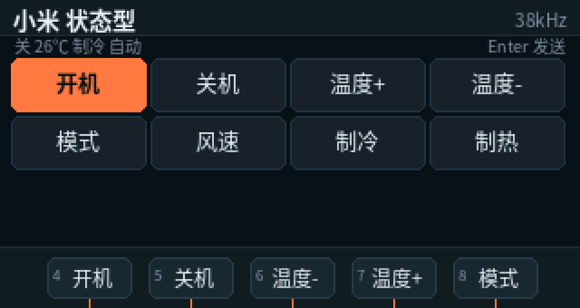

# Universal IR Remote for CardputerZero

A framebuffer-native infrared universal remote for the **M5Stack CardputerZero**
(Raspberry Pi CM0). No browser, no web server, no compositor: it draws straight
into `/dev/fb0`, reads the on-board TCA8418 keyboard, pulls IR codes from the
Xiaomi Mi Home code database and emits raw waveforms through `/dev/lirc0`.

Pairing follows the same flow as the Mi Home app: **device type → brand → code
set (trial power key) → remote**. Codes are cached on disk, so a remote that
works keeps working offline.

```
device type  →  brand  →  code set (trial power key)  →  remote
```

| Device types | Brand list (hot pinned, pinyin search) | Remote grid |
|---|---|---|
|  |  |  |

## Features

- **Native rendering** — 320×170 RGB565 written directly to the framebuffer,
  ~6 % CPU while idle, no X/Wayland involved.
- **Real code database** — device types, brands, code sets and IR patterns come
  from Xiaomi's own database, including the AES-encrypted pattern container.
- **Brand search** — type pinyin initials (`xm` → 小米, `md` → 美的) instead of
  scrolling 1800+ brands; hot brands for the current device type are pinned on top.
- **Stateful AC control** — power / temperature / mode / fan speed are encoded
  into a *single* full state frame, the same way Mi Home does it. Supports the
  compact rule layout (`1001/1003/1004/1005`, `1011/1012/1013`), bit rules
  (`1017`) and the Lua checksum hooks (`1518`/`1522`).
- **Trial-then-keep** — a code set is chosen by firing its power key; the last
  working remote is restored on the next launch.
- **One-key navigation** — the 8-cell grid is reachable from the 8 letter keys
  printed on the device; `F/X/Z/C` double as arrows.

## Requirements

Hardware: M5Stack CardputerZero (Pi CM0) with the 320×170 panel, TCA8418
keyboard and the GPIO IR transceiver (`/dev/lirc0` TX, `/dev/lirc1` RX).

Runtime: `python3 (>= 3.11)`, `python3-pil`, `python3-numpy`, `luajit`,
`v4l-utils`, `openssl`, `fonts-noto-cjk`.

No root is needed: the app runs as the desktop user, who has access to
`/dev/fb0` (`video` group), the keyboard node (`input` group) and
`/dev/lirc[01]` (`root:video 0660`).

## Install

Build the `.deb` first (see [Build from source](#build-from-source)) — `dpkg-deb`
is only needed at build time — then install it on the device:

```sh
sudo dpkg -i cp0-ir-remote_1.1.2_arm64.deb
```

The app shows up in APPLaunch as **Universal IR**. Restart the launcher after
installing so it re-scans `/usr/share/APPLaunch/applications`:

```sh
export XDG_RUNTIME_DIR=/run/user/1000
systemctl --user restart APPLaunch
```

## Build from source

`dpkg-deb` is required, so build on the device (or any arm64 Debian-ish host):

```sh
git clone https://github.com/RealOuO/czirremote.git
cd czirremote
VERSION=1.1.2 bash packaging/build_deb.sh
# -> build/cp0-ir-remote_1.1.2_arm64.deb
```

Run the self-test without touching any hardware:

```sh
python3 tests/selftest.py
```

## Key map

| Key | In lists | On the remote page |
|---|---|---|
| `F` / `X` (or `Fn`+`F/X`) | up / down | up / down |
| `Z` / `C` | page left / right | left / right |
| `4`…`8` | footer buttons | footer buttons |
| `Y U I O` | — | grid row 1 (开机, 关机, 温度+, 温度-) |
| `H J K L` | — | grid row 2 (模式, 风速, 制冷, 制热) |
| `Enter` | open | activate |
| `Tab` | toggle brand search | leave |
| `Esc` / `del` | back | back |

In brand search, letters are *text*, not navigation — use the footer keys
`4`…`7` to move, `8` to clear, `Tab` to exit.

## How it works

```
src/cp0_ir_remote.py   framebuffer UI, keyboard handling, screen state machine
src/miir.py            Xiaomi code database client (signing, AES+GZIP patterns)
src/kkac.py            stateful AC frame encoder (compact rules, 1017, Lua hooks)
src/cp0_pinyin.py      generated GB2312 pinyin-initial table for brand search
tools/gen_pinyin.py    regenerates cp0_pinyin.py from tools/brands.json
tools/rx_decode.py     decodes received frames from /dev/lirc1 (debug)
tools/probe_ac.py      prints the bytes each AC button actually changes (debug)
tests/selftest.py      headless test suite (616 lines)
```

`miir.py` handles the code database: request signing, then the pattern
container (AES-ECB + GZIP) that holds the raw IR timings. `kkac.py` is the AC
part: Xiaomi stores AC remotes as *state tables* rather than per-button codes,
so a press means "apply this state to the template frame and emit the whole
thing". The state lives in compact records — `[count][count bytes]` repeated —
where width 2 is `(byte index, value)` and width 3 is `(start bit, end bit,
value)`. Fields share bytes, so the write order is **fan → mode → temperature →
power**, with power last because it overwrites whole bytes.

## Notes and pitfalls

- **The launcher label must be ASCII.** APPLaunch renders tile labels with
  `Montserrat-Bold.ttf` only, with no CJK fallback, so a Chinese `Name=` renders
  as *blank* (not tofu). Hence `Name=Universal IR`. It also only reads the exact
  `Name` / `Icon` / `Exec` keys — `Name[zh_CN]=` is ignored.
- **Some AC tables cannot do temperature.** On e.g. Gree tables the temperature
  lives in the vendor SDK's native encoder rather than in the table, so the app
  reports *"this code set does not support it"* instead of sending a duplicate
  frame.
- **`luajit` is not optional.** The checksum hooks use `bit.*`; the system `lua`
  is 5.1 with no `bit32`, and its `loadfile` lacks the third argument, so it
  cannot substitute.
- **Self-loop RX is useless for waveform checking.** The transmitter AGC
  saturates the receiver, so you only see one blob. Use `tools/rx_decode.py`
  with a real remote instead.

## 中文说明

给 M5Stack CardputerZero（树莓派 CM0 核心）写的**原生红外万能遥控器**。不跑浏览器、不跑
Web 服务，直接往 `/dev/fb0` 画 320×170 的 RGB565，直接读板载 TCA8418 键盘，码库取自小米
米家（含 AES 加密的波形容器），发射走 `/dev/lirc0`。

- 配遥控的流程和米家一致：设备类型 → 品牌 → 方案组（试发电源键）→ 遥控器
- 品牌支持**拼音首字母搜索**（`xm` → 小米、`md` → 美的），当前设备类型的热门品牌置顶
- 空调是**状态型**码表：电源/温度/模式/风速合成一帧发出去，支持紧凑规则
  （`1001/1003/1004/1005`、`1011/1012/1013`）、位规则 `1017` 和 Lua 校验钩子 `1518/1522`
- 码表和遥控器状态都落盘缓存，断网也能用
- 不需要 root：普通桌面用户就在 `video` / `input` 组里，`/dev/fb0`、键盘节点、
  `/dev/lirc[01]` 都能直接读写

```sh
# 在设备上构建（需要 dpkg-deb）
VERSION=1.1.2 bash packaging/build_deb.sh
sudo dpkg -i build/cp0-ir-remote_1.1.2_arm64.deb
export XDG_RUNTIME_DIR=/run/user/1000 && systemctl --user restart APPLaunch
```

启动器里的名字是 **Universal IR**——APPLaunch 的磁贴标签只加载 `Montserrat-Bold.ttf`，
没有 CJK fallback，写中文会被渲染成**空白**（连方框都没有），所以只能用英文名。

## Credits and disclaimer

The IR code protocol implemented by `miir.py` (endpoint layout, request signing,
the AES/GZIP pattern container) was derived from
[ysard/mi_remote_database](https://github.com/ysard/mi_remote_database)
(AGPL-3.0). No code was copied — only protocol knowledge was used. The
stateful AC layout was reconstructed from the code tables Xiaomi serves and from
the `libkksdk` protocol; the tables themselves are not redistributed here.
[halifox/android_xiaomi_ir_lab](https://github.com/halifox/android_xiaomi_ir_lab)
was a useful reference for the AC side.

This is a personal hobby project. It is not affiliated with, endorsed by or
supported by Xiaomi or M5Stack. Remote code data is fetched at runtime from
Xiaomi's servers and belongs to its respective owners; it is cached locally for
personal use only. Use it with devices you own.

## License

[Apache-2.0](LICENSE)
