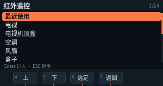
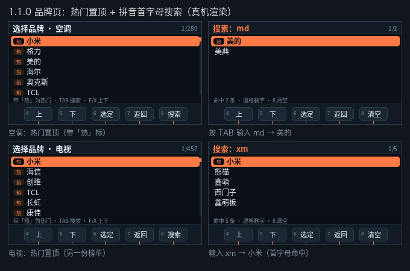
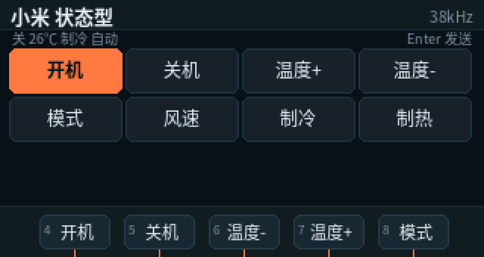

# CardputerZero 红外万能遥控器

[English](README.md) | **简体中文**

给 **M5Stack CardputerZero**（树莓派 CM0 核心）写的原生红外万能遥控器。不跑浏览器、
不跑 Web 服务、不经过合成器：直接往 `/dev/fb0` 画 320×170 的 RGB565，直接读板载
TCA8418 键盘，码库取自小米米家（含 AES 加密的波形容器），发射走 `/dev/lirc0`。

配遥控的流程和米家 App 一致：**设备类型 → 品牌 → 方案组（试发电源键）→ 遥控器**。
码表和遥控器选择都落盘缓存，配好一次的遥控器断网也能继续用。

```
设备类型  →  品牌  →  方案组（试发电源键）  →  遥控器
```

| 设备类型 | 品牌列表（热门置顶 + 拼音搜索） | 遥控网格 |
|---|---|---|
|  |  |  |

## 功能

- **原生渲染** —— 320×170 RGB565 直写帧缓冲，待机（静态页面）约 6% CPU，完全不经过
  X / Wayland。
- **真实码库** —— 设备类型、品牌、方案组、红外波形全部来自小米自己的码库，包括
  AES 加密的波形容器。
- **品牌搜索** —— 打拼音首字母（`xm` → 小米、`md` → 美的），不用在 1800+ 个品牌里
  一个个翻；当前设备类型的热门品牌置顶。
- **空调状态型控制** —— 电源 / 温度 / 模式 / 风速合成**一帧完整状态**发出去，和米家
  的做法一致。支持紧凑规则（`1001/1003/1004/1005`、`1011/1012/1013`）、位规则
  （`1017`）以及 Lua 校验钩子（`1518`/`1522`）。
- **试发即记** —— 靠试发电源键选定方案组，下次启动自动回到上次能用的遥控器。
- **一键直达** —— 网格 8 个格子对应键盘上印的 8 个字母键；`F/X/Z/C` 直接当方向键用。

## 环境要求

硬件：M5Stack CardputerZero（Pi CM0），带 320×170 屏、TCA8418 键盘、GPIO 红外收发
（`/dev/lirc0` 发射、`/dev/lirc1` 接收）。

运行时：`python3 (>= 3.11)`、`python3-pil`、`python3-numpy`、`luajit`、`v4l-utils`、
`openssl`、`fonts-noto-cjk`。

**不需要 root**：程序以普通桌面用户运行，该用户已在 `video` / `input` 组里，
`/dev/fb0`（video 组）、键盘节点（input 组）、`/dev/lirc[01]`（`root:video 0660`）
都能直接读写。

## 安装

先构建 `.deb`（见下方「从源码构建」，`dpkg-deb` 只在构建时需要），然后装到设备上：

```sh
sudo dpkg -i cp0-ir-remote_1.1.2_arm64.deb
```

启动器里显示的名字是 **Universal IR**。装完要重启启动器让它重新扫描
`/usr/share/APPLaunch/applications`：

```sh
export XDG_RUNTIME_DIR=/run/user/1000
systemctl --user restart APPLaunch
```

## 从源码构建

需要 `dpkg-deb`，所以要在设备上构建（或任意 arm64 的 Debian 系主机）：

```sh
git clone https://github.com/RealOuO/czirremote.git
cd czirremote
VERSION=1.1.2 bash packaging/build_deb.sh
# -> build/cp0-ir-remote_1.1.2_arm64.deb
```

不碰硬件也能跑自测：

```sh
python3 tests/selftest.py
```

## 键位

| 按键 | 列表页 | 遥控页 |
|---|---|---|
| `F` / `X`（或 `Fn`+`F/X`） | 上 / 下 | 上 / 下 |
| `Z` / `C` | 上一页 / 下一页 | 左 / 右 |
| `4`…`8` | 底栏按钮 | 底栏按钮 |
| `Y U I O` | — | 网格第一行（开机, 关机, 温度+, 温度-） |
| `H J K L` | — | 网格第二行（模式, 风速, 制冷, 制热） |
| `Enter` | 进入 | 选定 |
| `Tab` | 进入/退出品牌搜索 | 退出 |
| `Esc` / `del` | 返回 | 返回 |

品牌搜索状态下，字母键是**输入文字**而不是导航 —— 移动只能用底栏 `4`…`7`，
`8` 清空，`Tab` 退出搜索。

## 实现原理

```
src/cp0_ir_remote.py   帧缓冲 UI、键盘处理、页面状态机
src/miir.py            小米码库客户端（请求签名、AES+GZIP 波形容器）
src/kkac.py            空调状态帧编码（紧凑规则、1017 位规则、Lua 校验）
src/cp0_pinyin.py      生成的 GB2312 拼音首字母表，供品牌搜索
tools/gen_pinyin.py    从 tools/brands.json 重新生成 cp0_pinyin.py
tools/rx_decode.py     解析 /dev/lirc1 收到的帧（调试用）
tools/probe_ac.py      打印空调每个按键实际改了哪些字节（调试用）
tests/selftest.py      无头自测套件（616 行）
```

`miir.py` 负责码库：先做请求签名，再解开承载原始红外时序的波形容器
（AES-ECB + GZIP）。`kkac.py` 是空调那部分：小米把空调遥控存成**状态表**而不是
逐键码，所以按一次键的含义是「把这个状态套到模板帧上，整帧发出去」。状态存在紧凑
记录里 —— `[count][count 字节]` 重复若干段 —— 宽度 2 的记录是 `(字节下标, 值)`，
宽度 3 的是 `(起始位, 结束位, 值)`。几个字段共用同一个字节，所以写入顺序必须是
**风速 → 模式 → 温度 → 电源**，电源放最后，因为它会整字节覆盖。

## 注意事项（踩过的坑）

- **启动器标签只能用 ASCII。** APPLaunch 的磁贴文字只加载 `Montserrat-Bold.ttf`，
  没有 CJK fallback，写中文会被渲染成**空白**（连方框都没有，不是缺字方框）。所以
  `Name=Universal IR`。而且它只认精确的 `Name` / `Icon` / `Exec` 三个键，
  `Name[zh_CN]=` 是无效的。
- **部分空调码表做不出温度。** 比如格力的表，温度在厂商 SDK 的原生编码器里而不是
  在表里，所以程序会提示「该码表不支持」，而不是发一帧和上一档一模一样的码。
- **`luajit` 不是可选项。** 校验钩子用了 `bit.*`；系统自带的 `lua` 是 5.1，没有
  `bit32`，`loadfile` 也不支持第三个参数，替代不了。
- **自环接收看不出波形。** 发射端的 AGC 会把接收端压饱和，自发自收只能看到一团。
  要验证波形请用 `tools/rx_decode.py` 配真实遥控器。

## 致谢与免责

`miir.py` 实现的红外码库协议（接口布局、请求签名、AES/GZIP 波形容器）参考自
[ysard/mi_remote_database](https://github.com/ysard/mi_remote_database)（AGPL-3.0），
**没有拷贝其代码**，只用了协议知识。空调状态型布局是从小米下发的码表和 `libkksdk`
协议逆向还原的，码表本身不在本仓库内分发。空调部分还参考了
[halifox/android_xiaomi_ir_lab](https://github.com/halifox/android_xiaomi_ir_lab)。

这是个个人业余项目，与小米、M5Stack 均无关联，也未获其认可或支持。遥控码数据在
运行时从小米服务器获取，版权归各自所有者，仅在本地缓存供个人使用。请只对你自己的
设备使用。

## 许可证

[Apache-2.0](LICENSE)
